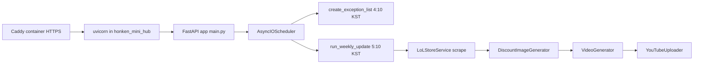

# Honken Mini Hub 프로젝트 개요

> 작성일: 2026-11-24
> 대상: 미니PC(Intel N100) 위에서 돌아가는 FastAPI 서버 및 주간 롤 스킨 할인 영상 자동화

---

## 1. 프로젝트 목적

**Honken Mini Hub**는 미니PC에서 돌아가는 FastAPI 서버입니다. 주요 역할은 세 가지입니다.

1. **롤 스토어 할인 스킨 수집:** Playwright로 LoL 한국 스토어를 열어 "할인 중" 스킨을 긁어옵니다.
2. **영상 제작 및 업로드:** 수집 결과로 이미지 15장과 MoviePy 영상을 만들고 YouTube에 업로드합니다.
3. **웹 서비스 제공:** 메인 페이지, 할인 API, 최신 영상 URL, 정적 페이지를 제공합니다.

---

## 2. 디렉터리 구조

```
honken_mini_hub/
├── app/
│   ├── main.py                  # FastAPI 진입점, 라우트, 시작 시 스케줄러 기동
│   ├── api/v1/                  # /api/v1 라우터 (endpoints/lol_store.py)
│   ├── core/
│   │   ├── scheduler.py         # APScheduler 작업 등록 (PT 기준)
│   │   └── config/              # YouTube 설정, client_secrets.json, oauth2.json
│   ├── models/lol_store.py      # 응답 Pydantic 모델
│   ├── services/
│   │   ├── lol_store/store.py   # 스크래핑 + 예외 필터 + 결과 저장
│   │   ├── content/             # ContentScheduler(작업 묶음), generator, publisher
│   │   ├── image_generator/     # 스킨별 PNG 생성 (Pillow)
│   │   ├── video/               # MoviePy로 영상 생성
│   │   ├── youtube/uploader.py  # YouTube Data API 업로드
│   │   └── slp/login.py         # SLP 로그인 (스케줄 해제, 코드만 남음)
│   ├── templates/index.html     # 메인 페이지
│   └── static/                  # CSS, JS, favicon (루트에 마운트)
├── data/
│   ├── lol_store/discounts.json       # 주간 결과
│   ├── lol_store/exception_list.json  # 예외 목록 (4:10 저장, 5:10 사용)
│   ├── lol_store/latest_video_id.txt  # 최신 영상 URL
│   ├── images/, videos/, audio/       # 생성물, BGM
├── Dockerfile                   # python:3.11-slim + Playwright/ffmpeg/ImageMagick
├── restart.sh                   # 빌드·재기동 스크립트 (로그 tail까지 실행)
├── Caddyfile                    # sizhawk.iptime.org -> 127.0.0.1:8000
├── requirements.txt             # fastapi, uvicorn, playwright, apscheduler, moviepy 등
└── .env.slp                     # SLP 계정 (USER_ID, PWD)
```

---

## 3. 구동 방식



### 사용 패키지와 역할

| 구성 요소 | 간단한 설명 | 이 프로젝트에서의 역할 |
|---|---|---|
| **Caddy** | 웹 서버이자 리버스 프록시. 도메인 요청을 받아 내부 서비스로 전달하고, HTTPS 인증서를 자동으로 발급·갱신합니다. | `sizhawk.iptime.org` 요청을 받아 `127.0.0.1:8000`의 FastAPI 서버로 넘깁니다. 외부 접속의 입구입니다. |
| **Docker** | 앱과 실행 환경을 이미지로 묶어 컨테이너로 실행하는 도구. | `honken_mini_hub` 컨테이너로 서버를 실행합니다. Python·Playwright·ffmpeg 등 환경을 이미지 안에 함께 넣습니다. |
| **Uvicorn** | Python 웹 앱을 실행하는 ASGI 서버. | `app.main:app`을 8000 포트에서 실행합니다. FastAPI 앱을 실제로 구동하는 프로세스입니다. |
| **FastAPI** | Python 웹 프레임워크. 라우트, 요청·응답 처리, 자동 문서화를 제공합니다. | `main.py`의 HTML·JSON 라우트와 `/api/v1` 라우터를 정의합니다. 시작 시 스케줄러도 켭니다. |
| **Pydantic** | 데이터 모델 검증 라이브러리. FastAPI가 응답 형식을 검사할 때 씁니다. | `app/models/lol_store.py`의 응답 모델에 쓰입니다. 지금 API 500 오류도 이 검사에서 발생합니다. |
| **APScheduler** | 파이썬 안에서 cron처럼 작업을 예약 실행하는 라이브러리. | 화요일 4:10·5:10(KST)에 해당하는 PT 월요일 11:10·12:10에 예외 목록 저장과 주간 갱신을 실행합니다. |
| **Playwright** | 헤드리스 브라우저로 실제 웹 페이지를 조작하는 도구. | LoL 스토어를 열고 스크롤하며 할인 스킨 정보를 긁어옵니다. |
| **Pillow** | 이미지 처리 라이브러리. | 스킨 이미지와 텍스트를 합쳐 1280×2266 크기의 PNG 15장을 만듭니다. |
| **MoviePy** | 파이썬으로 영상을 편집하는 라이브러리 (ffmpeg 사용). | PNG 이미지들을 이어 붙이고 BGM을 넣어 주간 할인 영상을 만듭니다. |
| **ffmpeg / ImageMagick** | 영상·이미지 변환을 위한 시스템 도구. | MoviePy 등이 내부적으로 사용합니다. 컨테이너 이미지에 설치되어 있습니다. |
| **google-api-python-client, google-auth-oauthlib, oauth2client** | Google API 호출과 OAuth2 인증을 위한 라이브러리. | YouTube Data API로 영상을 업로드합니다. OAuth2 토큰(`oauth2.json`)으로 인증합니다. |
| **python-dotenv** | `.env` 파일을 읽어 환경 변수로 넣어 주는 라이브러리. | `.env.slp`의 SLP 계정 정보를 불러옵니다. |
| **pytz** | 타임존 처리 라이브러리. | KST와 PT 시간대를 다루어 스케줄 시각과 날짜 표시를 맞춥니다. |
| **httpx, requests** | HTTP 요청 라이브러리. | `requests`는 SLP 로그인 요청과 이미지 다운로드에 쓰입니다. `httpx`는 requirements에 있으나 현재 코드에서 직접 쓰는 부분은 확인되지 않았습니다. |

### 배포
- `docker build` 후 `docker run`으로 올립니다. `--restart unless-stopped`를 사용합니다.
- 코드는 이미지에 복사되고, `data`, `app/core/config`, `.env.slp`만 볼륨으로 연결됩니다.
- **코드를 바꾸면 재빌드가 필요합니다.**

### 시작
- `main.py`의 `startup` 이벤트에서 `setup_scheduler()`를 호출합니다.

### 주간 작업 (미국 태평양 시간 기준)
- 월 11:10 PT: 예외 목록 저장 (`create_exception_list`)
- 월 12:10 PT: 주간 갱신 (`run_weekly_update`)
- 한국 시간으로는 화요일 4:10 / 5:10에 해당합니다. 미국 서머타임에 따라 자동으로 바뀝니다.

### 외부 연동
- LoL 스토어: Playwright 크롤링
- YouTube Data API: OAuth2
- SLP: 현재 스케줄 해제

---

## 4. API

| 경로 | 설명 | 상태 |
|---|---|---|
| `GET /` | 메인 HTML | 정상 |
| `GET /discounts` | 할인 목록 | 정상 |
| `GET /skin_discount` | 최신 영상 URL | 정상 |
| `GET /api/v1/lol-store/discounts` | 할인 목록 (v1) | 500 오류 (응답 모델은 `count`, `results`를 기대하지만 저장 구조는 `discounts`) |
| `GET /api/v1/lol-store/last-update` | 마지막 갱신 시각 (v1) | 오류 가능 (`get_last_update()` 메서드가 store에 없음) |
| `/lol-back-play/*` | 개인정보·약관 페이지 | 정상 |
| `/lime-voca/word-bank*` | 단어 목록 JSON | 정상 |

---

## 5. 미니PC 스펙

| 항목 | 값 |
|---|---|
| 모델 | 알리 N100 계열 미니PC (제조사 정보는 sudo 없이 확인 불가) |
| CPU | Intel N100, 4코어 4스레드, 최대 3.4GHz |
| 메모리 | 7.5GiB (스왑 4GiB) |
| 저장장치 | 238.5GB × 2 (sda, sdb). `/`는 sda3 기반 LVM 100GB |
| 디스크 사용량 | `/` 98GB 중 69GB 사용 (74%), 25GB 남음 (도커 빌드 캐시 42GB, 재사용 가능 이미지 6.8GB 포함) |
| sda | Ubuntu 설치 디스크. sda1(EFI), sda2(/boot), sda3(LVM → `/`) |
| sdb | 이전 Windows 설치 디스크. sdb1(EFI, vfat), sdb3(Windows, NTFS), sdb4(복구, NTFS). 마운트되지 않으며 **현재 사용하지 않음**. 삭제 없이 유지 중 |
| OS | Ubuntu Server 24.04.2 LTS (GUI 없음, `ubuntu-server` 패키지 설치, `ubuntu-desktop` 미설치) |
| 커널 | 6.8.0-147-generic (x86_64) |
| 호스트 Python | 3.12.3 |
| Docker | 28.1.1 (overlay2) |
| 업타임 | 약 13일 (작성 시점 기준) |
| 실행 중 컨테이너 | `honken_mini_hub`, `caddy` |
| 실행 중 서비스 | cron, docker, ssh |

---

## 6. 리팩토링 전 참고 사항

- **API 두 개가 깨져 있습니다.** `/api/v1/lol-store/*`는 현재 저장 구조와 맞지 않습니다.
- **스토어 인스턴스가 3개입니다.** 스케줄러의 두 작업과 API 엔드포인트가 각각 `LoLStoreService`를 만듭니다. 메모리 상태가 서로 따로 놀기 때문에 예외 목록 문제가 생겼습니다. 하나로 모으거나 파일을 기준으로 읽도록 바꾸는 편이 낫습니다.
- **비밀 파일이 프로젝트 안에 있습니다.** `client_secrets.json`, `oauth2.json`, `.env.slp`가 있으니 `.gitignore` 포함 여부를 확인해야 합니다.
- **설정 파일이 섞여 있습니다.** `settings.py`에는 쓰지 않는 DB 설정과 빈 키가 있습니다.
- **README가 오래됐습니다.** `exception_results.json`, `utils/` 등 현재와 다른 내용이 있습니다.
- **SLP 코드가 남아 있습니다.** 스케줄은 꺼졌지만 `ContentScheduler`가 `SLPLoginService`를 여전히 만듭니다.
- **Caddy로 외부에 공개되어 있습니다.** `sizhawk.iptime.org`가 열려 있으니 리팩토링 때 인증이나 접근 제한을 함께 고려해야 합니다.
- **테스트 코드가 없습니다.** `tests/`에는 `__init__.py`만 있습니다. 예외 목록·필터 로직 테스트를 먼저 만들어 두면 안전합니다.
